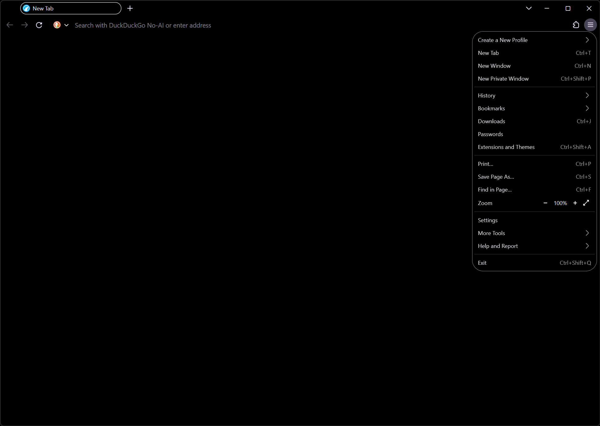

# My minimal theme for Firefox/Librewolf

1. In `Settings` > `Appearance` > `Browser theme`, tick "Allow userChrome.css customization".
2. Go to the current profile folder:

```
# Windows
cd %APPDATA%\librewolf\Profiles\*default-default

# Linux
cd ~/.librewolf/*default-default

# Linux (flatpak)
cd ~/.var/app/io.gitlab.librewolf-community/.librewolf/*default-default
```
3. Clone this repo into a folder called `chrome`:

```
git clone git@github.com:derryleng/minimal-firefox-theme.git chrome
```


